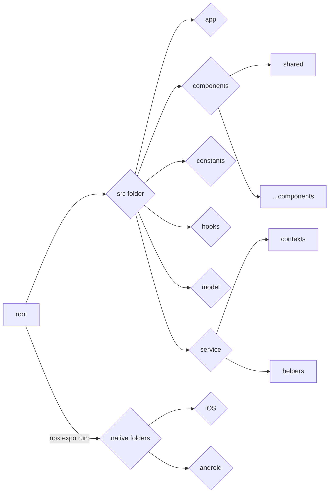

# [New Architecture Example](https://reactnative.dev/docs/the-new-architecture/landing-page)

## 🚀 How to use

> `npx create-expo-app@latest -e with-new-arch`

- Install packages with `yarn` or `npm install`.
- Run `npx expo start` to start the Metro server and connect with Expo Go.
- Or Run `npx expo run:ios` and/or `npx expo run:android`. Requires native toolchains to be installed.

# LBi Instructions

- For our use case, we will just use `npx expo start -c`. The `-c` will clear the cache, so you'll never have an issue with the cache preventing you from seeing your latest changes in the project.

- **IMPORTANT:** When testing changes to the application, please test them on a mobile device whether that be Android or iOS operating system. It should be noted that certain functionality may work in 1 operating system, but not the other.

- If you would like to run the project via an Android platform on your PC, you must follow the steps from the expo documentation in order to do so. (You need Android Studio and a virtual device set up)

- **Keep in mind:** Using the Expo Go app will suit all the purposes we need to this path is not recommended.

- https://docs.expo.dev/workflow/android-studio-emulator/

## iOS Build Requirements :warning:

- MacOS version at least Big Sur (11.7.10)

- XCode version at least 15.1

### iOS and Android compilation

For mobile compilation we should run the command `npx expo prebuild --clean` to recreate the `/android` and `/ios` folders whenever we update our dependencies.

Once the application is prebuilt, build it with `npx expo run:ios` and/or `npx expo run:android`.

## Folder Structure

## Application features

Features were develop with some external libraries installed on the project, here we list some of them, the source and the documentation:

| Feature             | Lib link                                                            | Version |
| ------------------- | ------------------------------------------------------------------- | ------- |
| Request to backend  | https://axios-http.com/docs/intro                                   | 1.6.5   |
| Camera.             | https://docs.expo.dev/versions/latest/sdk/camera/                   | 14.1.1  |
| Modals              | https://github.com/react-native-modal/react-native-modal            | 13.0.1  |
| Location            | https://docs.expo.dev/versions/latest/sdk/location/                 | 16.5.5  |
| OCR                 | https://www.npmjs.com/package/@react-native-ml-kit/text-recognition | 1.5.1   |
| NFC Manager         | https://github.com/revtel/react-native-nfc-manager                  | 3.14.13 |
| Search              | https://github.com/lucaong/minisearch                               | 6.3.0   |
| Toast               | https://github.com/calintamas/react-native-toast-message            | 2.2.0   |
| Storage and persist | https://docs.expo.dev/versions/latest/sdk/securestore/              | 12.8.1  |
| Drawer              | https://reactnavigation.org/docs/drawer-based-navigation/           | 6.6.6   |
| Navigation          | https://reactnavigation.org/docs/stack-navigator/                   | 6.3.20  |
| Quering             | https://tanstack.com/query/latest                                   | 5.17.19 |
